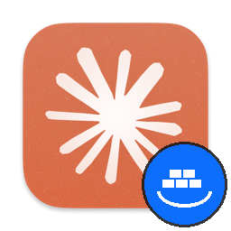

# Claude Desktop in Docker (Linux GUI)

Runs the official **Claude Desktop** app (Anthropic APT package) inside a Docker container on a Linux desktop, shown on the host screen through X11 (XWayland). It runs side by side with a host-installed Claude Desktop, keeps its own login, keyring and settings, and shows up in the dock as a separate **Claude (Docker)** app.



---

## Host requirements

The setup is built and tested on this exact host. Other setups may work but are untested.

| Item | Tested value | Why it matters |
|---|---|---|
| OS | **Ubuntu 24.04 LTS** (24.04.5), amd64 | The image is also Ubuntu 24.04. The Claude Desktop APT repo is amd64/arm64 only, and the Chrome `.deb` in the Dockerfile is **amd64 only**. |
| Desktop | **GNOME Shell 46** (`ubuntu:GNOME`) with **Ubuntu Dock** (`ubuntu-dock@ubuntu.com`) | The dock groups windows by `WM_CLASS` → `StartupWMClass` in `.desktop` files. See [Dock grouping](#dock-grouping-wm_class). |
| Session | **Wayland** with **XWayland** enabled | The app draws through the X11 socket `/tmp/.X11-unix` (XWayland). No Wayland socket is mounted. `DISPLAY` is usually `:0`. |
| X access | `xhost` installed (`x11-xserver-utils`) | `run.sh` runs `xhost +si:localuser:$USER` so the container (same UID) may connect to XWayland. |
| Docker | Docker Engine + **Compose v2 plugin** (tested 29.x / Compose v5.x) | `docker compose` (not `docker-compose`). |
| User | Host user with **UID/GID 1000:1000**, member of the `docker` group | The container user `claude` is built with your UID/GID so files in bind mounts have the right owner. `run.sh` passes `id -u`/`id -g`; the docker group GID (e.g. **984**) is added to the container user so it can use `/var/run/docker.sock`. |
| Audio | PulseAudio API socket at `$XDG_RUNTIME_DIR/pulse/native` (PipeWire's `pipewire-pulse` works) | Mounted read-only at the same path; `PULSE_SERVER` points at it. |
| GPU | `/dev/dri` (Mesa: Intel/AMD) | Passed through for hardware acceleration. NVIDIA proprietary drivers would need extra setup. |
| Kernel | tested on 7.0 | Nothing kernel-specific; listed for reference. |

Host-side files that live **outside this repo** and must exist:

- `~/.local/share/applications/claude-docker.desktop`: the launcher (contents below).
- `~/.local/share/icons/hicolor/{16,32,48,64,128,256}x…/apps/claude-docker.png`: launcher icons (Claude logo with a Docker badge; the 256 px source is `assets/icon.png`).
- `~/.ssh`, `~/.gitconfig`, `~/.config/git/`: mounted read-only into the container.
- Your project folders, listed in `docker-compose.override.yml`. Docker creates any missing ones **owned by root**, so create them first.

---

## Quick start

```bash
cp .env.example .env        # optional, fill in Sentry values
cp docker-compose.override.example.yml docker-compose.override.yml   # list your project folders
docker compose build        # first time, and after every Dockerfile change
./run.sh
```

Or launch **Claude (Docker)** from the GNOME app grid / dock.

`run.sh` only builds the image **if it does not exist yet**. After you change the Dockerfile you must run `docker compose build` yourself.

### What `run.sh` does

1. Allows the local user to connect to the X server (`xhost +si:localuser:$(whoami)`).
2. Exports `USER_UID`, `USER_GID`, `DOCKER_GID`, `DISPLAY`, `WAYLAND_DISPLAY`, `XDG_RUNTIME_DIR` for compose.
3. Creates `/tmp/claude-$UID` (mode 700) so Docker doesn't create it owned by root.
4. Builds the image if missing.
5. Runs `docker compose run --rm claude-desktop "$@"`. Arguments go to the entrypoint: a `claude://…` URL or `--flag` goes to Claude Desktop, anything else (e.g. `bash`) runs as a command instead.

### Shell inside the running container

`docker compose run` gives the container a generated name (`claudecontainer-claude-desktop-run-<id>`), **not** `claude-desktop`:

```bash
docker exec -it $(docker ps -qf name=claudecontainer-claude-desktop-run) bash
```

Or start a standalone shell in a new container: `./run.sh bash`.

### Upgrading Claude Desktop

The Dockerfile has `ARG CLAUDE_VERSION` in front of a final `apt-get upgrade`. Bump its value (any change works) and rebuild. Only that layer and the layers after it run again, so you get the newest `claude-desktop` and system packages without reinstalling everything:

```bash
docker compose build --build-arg CLAUDE_VERSION=$(date +%s)
```

---

## Desktop launcher

`~/.local/share/applications/claude-docker.desktop` (replace `/path/to/claude-container` with where you cloned this repo):

```ini
[Desktop Entry]
Name=Claude (Docker)
Comment=Claude Desktop running isolated inside Docker
GenericName=AI Assistant (Docker)
Exec=/path/to/claude-container/run.sh %U
Icon=claude-docker
Type=Application
Terminal=false
StartupNotify=true
StartupWMClass=claude-docker
Categories=Development;
Keywords=AI;Chat;Assistant;Claude;Code;LLM;Docker;
Actions=NewChat;NewCode;

[Desktop Action NewChat]
Name=New Chat
Exec=/path/to/claude-container/run.sh "claude://claude.ai/new?surface=chat&source=desktop_action"

[Desktop Action NewCode]
Name=New Claude Code Session
Exec=/path/to/claude-container/run.sh "claude://code/new?source=desktop_action"
```

The entry deliberately has **no** `MimeType=x-scheme-handler/claude`. The host's `com.anthropic.Claude.desktop` stays the `claude://` handler on the host, and inside the container the `xdg-open` shim handles those links.

### Dock grouping (WM_CLASS)

Electron sets the window class from the app's `desktopName`, so both host Claude and container Claude report `WM_CLASS = com.anthropic.Claude`. The host's `/usr/share/applications/com.anthropic.Claude.desktop` has `StartupWMClass=com.anthropic.Claude`. Without a fix, the dock files the container window under **host** Claude (two "host" windows, no Docker icon running).

Electron ignores `--class`, so `entrypoint.sh` starts a background loop that renames any `com.anthropic.claude` window to `claude-docker` once a second (`xdotool set_window --class/--classname`). GNOME Shell sees the change and moves the window to `claude-docker.desktop`. This works only because the app runs through X11/XWayland. A native Wayland window has an `app_id` instead, and nothing outside the app can change it.

---

## Container layout

### Image (`Dockerfile`)

Base `ubuntu:24.04`. Layers are ordered so the slow ones (Claude Desktop, Chrome) stay cached. **Add new packages in a new layer near the end**, not in the first `apt-get install`.

| Layer | Contents |
|---|---|
| Base deps | X11/Electron runtime libs, Mesa, fonts, `dbus-x11`, `libsecret`, `git`, `nodejs`/`npm` (Ubuntu's v18), `python3` + `pip` + `venv` |
| Claude Desktop | Anthropic APT repo `downloads.claude.ai/claude-desktop/apt/stable`, package `claude-desktop` |
| User | removes the default `ubuntu` user, creates `claude` with `USER_UID:USER_GID`, groups `audio`,`video` (+`render` if present), passwordless `sudo` |
| CLI tools | `gh`, `docker.io` (CLI only, talks to the host daemon), `python-is-python3`, `sentry-cli` |
| Chrome | `google-chrome-stable` (amd64 `.deb`), wrapped so it always runs with `--no-sandbox` |
| `xdg-open` shim | `/usr/local/bin/xdg-open`: `claude://` → `claude-desktop --no-sandbox`, `http(s)://` → Chrome, else the real `xdg-open` |
| Keyring | `gnome-keyring` |
| Tools | `openssh-client`, `rsync`, `xdotool` |
| Upgrade | `ARG CLAUDE_VERSION` + `apt-get upgrade` (cache buster) |
| Icons | `assets/*` copied over `/usr/lib/claude-desktop/resources/` (also bind-mounted at runtime) |

`--no-sandbox` is needed for Electron and Chrome because the container doesn't allow the user namespaces / setuid `chrome-sandbox` they need.

### Entrypoint (`entrypoint.sh`, bind-mounted, so edits apply on the next start without a rebuild)

1. Creates `XDG_RUNTIME_DIR=/tmp/runtime-claude` (mode 700; container-private).
2. Starts a private D-Bus session bus (`dbus-launch`).
3. Starts a private `gnome-keyring-daemon` (secrets component) with an empty-password `login` keyring. The app stores encrypted tokens here; the host keyring is never touched.
4. Patches the container's `com.anthropic.Claude.desktop` so `claude://` handling inside the container uses `--no-sandbox`.
5. Starts the WM_CLASS rename loop (see above).
6. `exec claude-desktop --no-sandbox "$@"` (or runs the given command).

### Compose (`docker-compose.yml`)

- `network_mode: host`: the app sees host networking (localhost dev servers, OAuth callbacks).
- `ipc: host`: Chromium needs a large shared memory area; without it the renderer crashes.
- `group_add: DOCKER_GID` + `/var/run/docker.sock`: Docker outside of Docker.
- `devices: /dev/dri`: GPU.

### Mounts

| Host | Container | Mode | Purpose |
|---|---|---|---|
| `/tmp/.X11-unix` | same | ro | X11 / XWayland display socket |
| `$XDG_RUNTIME_DIR/pulse/native` | same path | ro | audio |
| `/dev/dri` | same | rw | GPU |
| `~/.ssh` | `/home/claude/.ssh` | **ro** | SSH keys for git / ssh / rsync |
| `~/.gitconfig` | `/home/claude/.gitconfig` | **ro** | your git identity, aliases, editor |
| `~/.config/git` | `/home/claude/.config/git` | **ro** | global gitignore |
| `/tmp/claude-$UID` | same path | rw | Claude's temp/scratchpad dir, shared with the host Claude |
| folders from `docker-compose.override.yml` | e.g. `/home/claude/Projects` | rw | projects |
| `/var/run/docker.sock` | same | rw | host Docker daemon |
| `./entrypoint.sh` | `/usr/local/bin/entrypoint.sh` | ro | live-editable entrypoint |
| `./assets/*.png` | `/usr/lib/claude-desktop/resources/…` | ro | Docker-badged window and tray icons |
| named volume `claudecontainer_claude-home` | `/home/claude` | rw | persistent home: Claude login and settings, keyring, `gh`, `sentry-cli`, MCP configs |

---

## Known constraints and gotchas

- **Read-only mounts.** `git config --global …` fails inside the container. Change global git config on the host instead; per-repo config works. ssh can't write `~/.ssh/known_hosts`, so new hosts get a warning on every connect and are never remembered.
- **Docker outside of Docker paths.** The Docker daemon runs on the host, so bind-mount paths in `docker run -v` / compose files run from inside the container are resolved **on the host**. Projects live under `/home/claude/…` in the container but under `/home/<you>/…` on the host, so absolute container paths won't match. Relative paths in a compose file are resolved by the compose CLI to container paths and then break. Run compose stacks that use bind mounts from the host, or use host paths.
- **Shared `/tmp/claude-1000`.** Host and container Claude both write here. Per-project subfolders are named after the project path (`-home-<you>-…` on the host, `-home-claude-…` in the container), so they don't clash in practice.
- **Home volume masks the image home.** `/home/claude` comes from the named volume. Files the Dockerfile puts in the home folder appear only the first time the volume is created. Delete the volume (`docker volume rm claudecontainer_claude-home`) to reset, which also **logs you out** and wipes settings.
- **Missing bind sources become root-owned directories.** If a mounted host path doesn't exist, Docker creates it as root. `run.sh` handles this for `/tmp/claude-$UID`; create project folders yourself.
- **Single instance per home.** Host and container Claude don't see each other's single-instance lock (different homes). Running `./run.sh` twice starts a second container that shares the same home volume, which is untested; use one container at a time.
- **UID mismatch.** If your host UID isn't 1000, rebuild (`run.sh` passes your UID as a build arg). `.ssh` key permissions and bind-mount ownership depend on it.
- **XWayland only.** `WAYLAND_DISPLAY` is passed but the Wayland socket isn't mounted, so Electron runs on X11. Fractional scaling may look blurry under XWayland. Don't mount the Wayland socket: the dock grouping fix needs X11.
- **`.env` holds secrets** (`SENTRY_AUTH_TOKEN`). Don't commit or share it; `.env.example` is the template.

---

## Isolation and safety

- Private D-Bus and gnome-keyring inside the container; the host keyring / KWallet are never used.
- Credentials live encrypted in `/home/claude/.local/share/keyrings` on the named volume.
- Runs as non-root user `claude` (same UID as the host user). The user has passwordless `sudo` inside the container.
- SSH keys and git config are read-only.
- **Not a security boundary:** the Docker socket gives the container root-equivalent access to the host, and `network_mode: host` / `ipc: host` share host namespaces. This setup is for convenience (a separate app instance and identity), not for sandboxing untrusted code.

---

## Installed tools in the container

`claude-desktop`, `google-chrome-stable`, `git`, `gh`, `docker` (CLI), `sentry-cli`, `ssh`, `rsync`, `curl`, `xdotool`, `node` 18 + `npm`, `python3` 3.12 + `pip` + `venv`, `sudo`.

Sentry auth: either run `sentry-cli login` inside the container (stored in `~/.sentryclirc` on the volume) or set `SENTRY_AUTH_TOKEN`, `SENTRY_URL` and `SENTRY_ORG` in `.env`.

---

## Troubleshooting

| Symptom | Check |
|---|---|
| `cannot open display` / blank window | `xhost` ran? `echo $DISPLAY` on the host; is XWayland running (`ls /tmp/.X11-unix`)? |
| Dock shows two host Claude icons | Is `xdotool` in the image (`docker compose build`)? Check the class with `xprop WM_CLASS` and click the window; it should say `claude-docker`. |
| Renderer crashes / white screen | `ipc: host` present; try removing GPU mounts to rule out the driver. |
| `permission denied` on docker.sock | `getent group docker` GID matches `DOCKER_GID`; rebuild not needed, just restart. |
| Login lost after restart | Keyring files in the volume: `ls ~/.local/share/keyrings` in the container. |
| No sound | `ls -la $XDG_RUNTIME_DIR/pulse/native` on the host. |
| New Dockerfile change not applied | `run.sh` doesn't rebuild an existing image: run `docker compose build`. |
